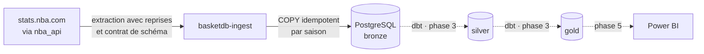

# BasketDB Factory


Pipeline ELT de données NBA : ingestion robuste depuis stats.nba.com, entrepôt PostgreSQL en architecture médaillon, orchestration Airflow, modélisation dbt et dashboard Power BI.

## Question analytique

**Peut-on expliquer le résultat d'un match avant qu'il soit joué ?** Avantage du terrain, jours de repos, matchs consécutifs, forme récente : le projet mesure le poids de chaque facteur sur les saisons régulières 2015-16 à 2025-26.

## Architecture



Traits pleins : construit. Pointillés : à venir. Airflow orchestrera l'ensemble à partir de la phase 2.

## Avancement

| Phase | Contenu | État |
|---|---|---|
| 0 | Environnement local, validation de la source | ✅ `v0.1.0` |
| 1 | Ingestion Bronze : 11 saisons, 307 581 lignes | ✅ `v0.2.0` |
| 2 | Orchestration Airflow | En cours |
| 3 | Modélisation dbt (Silver, Gold), tests et lineage | À venir |
| 4 | Dashboard Power BI | À venir |

## Démarrage rapide

Prérequis : Python 3.12 et PostgreSQL 16, avec le rôle et la base décrits dans [docs/setup.md](docs/setup.md).

```bash
git clone git@github.com:ouahidyassine/basketdb-factory.git
cd basketdb-factory
python3 -m venv .venv
source .venv/bin/activate
pip install -e ".[dev]"
cp .env.example .env          # puis renseigner POSTGRES_PASSWORD
basketdb-ingest --from 2015-16 --to 2025-26
```

Le backfill complet prend environ 1 min 30. Il est idempotent : le relancer remplace chaque saison à l'identique, sans doublon.

## Qualité

- **52 tests** (`pytest`) : 48 tests unitaires, sans réseau ni base, et 4 tests d'intégration contre PostgreSQL, exécutés dans une transaction annulée.
- **CI GitHub Actions** : `ruff` et `pytest` sur chaque pull request ; `main` est protégée, aucune fusion n'est possible sans CI verte.
- **7 contrôles de qualité des données** sur Bronze : grain, cardinalité, cohérence métier, intégrité référentielle, complétude.

```bash
pytest
psql -h localhost -p 5433 -U basketdb_user -d basketdb -f sql/checks/bronze_quality.sql
```

## Structure du dépôt

```
basketdb-factory/
├── src/basketdb/          # package : configuration, extraction, contrat, chargement, CLI
│   └── sql/bronze/        # DDL de la couche Bronze, embarqué dans le package
├── tests/                 # tests unitaires et d'intégration
├── sql/checks/            # contrôles de qualité des données
├── sql/exploration/       # requêtes de profilage
├── docs/                  # installation, décisions d'architecture, documentation des données
├── spikes/                # test de faisabilité de la source
└── .github/workflows/     # intégration continue
```

## Documentation

- [Installation de l'environnement local](docs/setup.md)
- [Couche Bronze : tables, volumes, contrôles, couverture des données](docs/data/bronze.md)
- [ADR 0001 : choix de la source de données](docs/decisions/0001-source-nba-api.md)
- [ADR 0002 : stratégie de chargement de Bronze](docs/decisions/0002-bronze-loading-strategy.md)