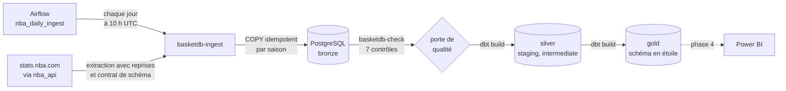
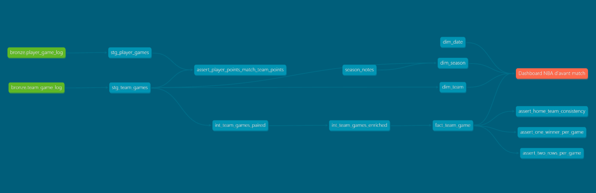

# BasketDB Factory


Pipeline ELT de données NBA : ingestion Python idempotente, entrepôt PostgreSQL en architecture médaillon, orchestration Airflow, transformations et tests dbt, dashboard Power BI.

## Question analytique

**Peut-on expliquer le résultat d'un match avant qu'il soit joué ?** Avantage du terrain, jours de repos, matchs consécutifs, forme récente : le projet mesure le poids de chaque facteur sur les saisons régulières 2015-16 à 2025-26.

### Premier résultat

| Saisons | Victoires à domicile |
|---|---|
| 2015-16 à 2018-19 | 58 % à 59 % |
| Depuis 2019-20 | 54 % à 55 %, sauf 2022-23 (58 %) |

Hors matchs sur terrain neutre. La saison 2020-21, jouée en grande partie sans public, est au niveau des saisons récentes avec public : le public n'explique pas, à lui seul, la baisse de l'avantage du terrain.

## Architecture



Traits pleins : construit. Pointillés : à venir. Chaque jour, le DAG recharge la saison en cours, contrôle Bronze, puis reconstruit et teste Silver et Gold, en une douzaine de secondes.

### Lineage dbt



### Modèle de données (Gold)

| Table | Grain | Contenu |
|---|---|---|
| `fact_team_game` | Une ligne par équipe et par match | Résultat, points, et variables d'avant-match (lieu, repos, back-to-back, forme), pour l'équipe et son adversaire |
| `dim_team` | Une ligne par équipe | Dernier nom et dernière abréviation connus |
| `dim_date` | Une ligne par jour | Mois, jour de la semaine, saison |
| `dim_season` | Une ligne par saison | Matchs joués, saison raccourcie, saison terminée |

## Avancement

| Phase | Contenu | État |
|---|---|---|
| 0 | Environnement local, validation de la source | ✅ `v0.1.0` |
| 1 | Ingestion Bronze : 11 saisons, 307 581 lignes | ✅ `v0.2.0` |
| 2 | Orchestration Airflow : DAG quotidien, porte de qualité | ✅ `v0.3.0` |
| 3 | Modélisation dbt : Silver, Gold, tests et lineage | ✅ `v0.4.0` |
| 4 | Dashboard Power BI | À venir |

## Démarrage rapide

Prérequis : Python 3.12 et PostgreSQL 16, avec le rôle et la base décrits dans [docs/setup.md](docs/setup.md).

```bash
git clone git@github.com:ouahidyassine/basketdb-factory.git
cd basketdb-factory
python3 -m venv .venv
source .venv/bin/activate
pip install -e ".[dev,dbt]"
cp .env.example .env          # puis renseigner POSTGRES_PASSWORD
basketdb-ingest --from 2015-16 --to 2025-26
set -a; source .env; set +a   # variables lues par le profil dbt
dbt deps --project-dir dbt --profiles-dir dbt
dbt build --project-dir dbt --profiles-dir dbt
```

Le backfill prend environ 1 min 30, et `dbt build` quelques secondes. Les deux sont idempotents : les relancer reconstruit le même état, sans doublon.

## Orchestration

Le DAG `nba_daily_ingest` enchaîne chaque jour à 10 h UTC `ingest_team`, `ingest_player`, `check_bronze_quality` et `dbt_build`. Une violation d'un contrôle de Bronze, ou d'un test dbt, fait échouer le run avant que la donnée n'atteigne Gold. Prérequis : Airflow 3.3.2 dans son propre venv, avec `AIRFLOW__CORE__DAGS_FOLDER` pointant vers le dossier `dags/` du dépôt (voir [docs/setup.md](docs/setup.md)).

```bash
source ~/venvs/airflow/bin/activate
airflow standalone                        # interface web sur le port configuré
airflow dags unpause nba_daily_ingest     # dans un second terminal
```

## Qualité

- **Tests Python** (`pytest`) : 59 tests unitaires et 6 tests d'intégration contre PostgreSQL, dans une transaction annulée ; 6 tests du DAG (import, tâches, ordre, planification, reprises).
- **Tests dbt** : 54 tests génériques (grain, valeurs manquantes, relations, plages) et 4 tests singuliers sur les règles du basket, dont le rapprochement des points des joueurs avec ceux de l'équipe.
- **7 contrôles de qualité de Bronze**, exécutés par `basketdb-check` avant toute transformation.
- **CI GitHub Actions**, deux jobs en parallèle sur chaque pull request : `ruff`, `pytest` et `dbt parse` dans l'environnement du projet ; l'import et la structure du DAG dans un environnement Airflow isolé. `main` est protégée : aucune fusion sans les deux checks verts.

```bash
pytest
basketdb-check
dbt build --project-dir dbt --profiles-dir dbt
```

## Structure du dépôt

```
basketdb-factory/
├── src/basketdb/          # package : configuration, extraction, contrat, chargement, CLI
│   └── sql/               # SQL exécuté par le code : DDL Bronze, contrôles de qualité
├── dags/                  # DAG Airflow : ingestion, contrôle, transformations
├── dbt/                   # projet dbt
│   ├── models/            # staging et intermediate (silver), marts (gold)
│   ├── tests/             # tests singuliers : règles du basket
│   ├── seeds/             # données de référence : saisons particulières
│   └── macros/            # nommage des schémas
├── tests/                 # tests Python : unitaires, intégration, DAG
├── sql/exploration/       # requêtes de profilage
├── docs/                  # installation, décisions, documentation des données, images
├── spikes/                # test de faisabilité de la source
└── .github/workflows/     # intégration continue
```

## Documentation

- [Installation de l'environnement local](docs/setup.md)
- [Couche Bronze : tables, volumes, contrôles, couverture des données](docs/data/bronze.md)
- [ADR 0001 : choix de la source de données](docs/decisions/0001-source-nba-api.md)
- [ADR 0002 : stratégie de chargement de Bronze](docs/decisions/0002-bronze-loading-strategy.md)
- [ADR 0003 : orchestration de l'ingestion avec Airflow](docs/decisions/0003-orchestration-strategy.md)
- [ADR 0004 : modélisation des couches Silver et Gold avec dbt](docs/decisions/0004-data-modeling.md)
- Documentation dbt (modèles, colonnes, tests, lineage) : `dbt docs generate` puis `dbt docs serve --port 8082`, avec les options `--project-dir dbt --profiles-dir dbt`
