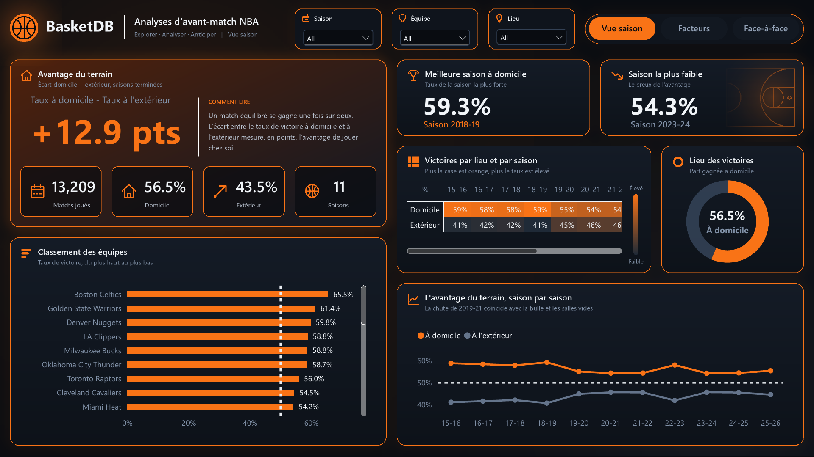
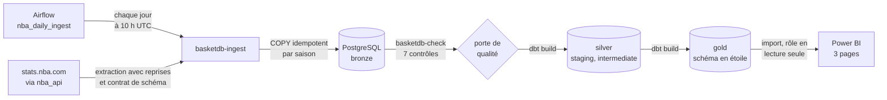
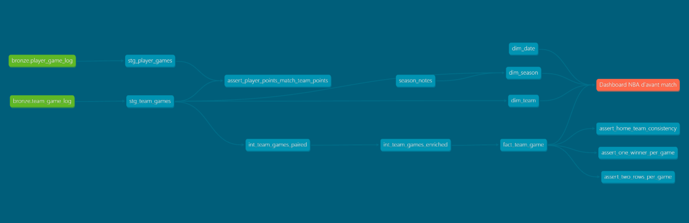
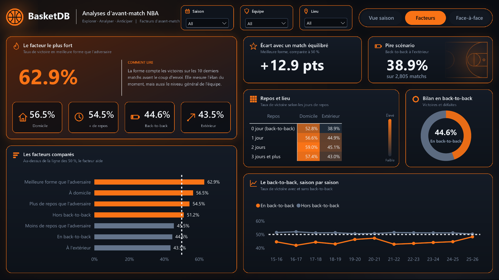
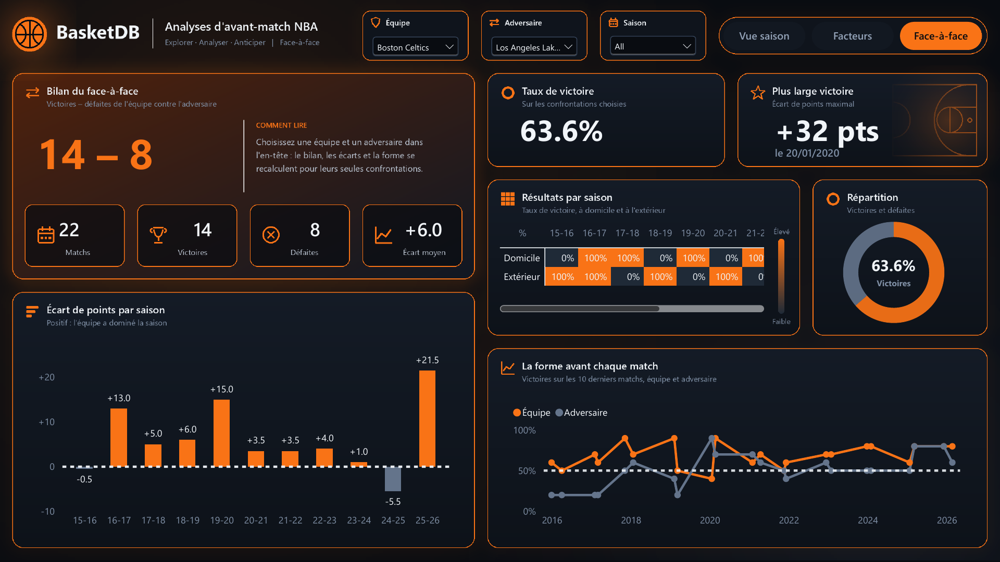

# BasketDB Factory


Pipeline ELT de données NBA : ingestion Python idempotente, entrepôt PostgreSQL en architecture médaillon, orchestration Airflow, transformations et tests dbt, dashboard Power BI.



## Question analytique

**Peut-on expliquer le résultat d'un match avant qu'il soit joué ?** Avantage du terrain, jours de repos, matchs consécutifs, forme récente : le projet mesure le poids de chaque facteur sur les saisons régulières 2015-16 à 2025-26.

### Résultats

Sur 13 209 matchs, aucun facteur ne décide seul d'un match, mais chacun déplace nettement la probabilité de victoire autour de 50 % :

| Situation de l'équipe avant le match | Taux de victoire |
|---|---|
| Meilleure forme que l'adversaire | 62,9 % |
| À domicile | 56,5 % |
| Plus de repos que l'adversaire | 54,5 % |
| Pas en back-to-back | 51,2 % |
| Moins de repos que l'adversaire | 45,5 % |
| En back-to-back (deuxième match en deux jours) | 44,6 % |
| À l'extérieur | 43,5 % |
| En back-to-back **et** à l'extérieur | 38,9 % (2 805 matchs) |

La forme, mesurée sur les 10 derniers matchs, est le facteur le plus fort, mais elle reflète aussi le niveau général de l'équipe, pas seulement l'élan du moment. Les handicaps se cumulent : un back-to-back à l'extérieur fait perdre plus de 6 matchs sur 10.

### L'avantage du terrain dans le temps

| Saisons | Victoires à domicile |
|---|---|
| 2015-16 à 2018-19 | 58 % à 59 % |
| Depuis 2019-20 | 54 % à 55 %, sauf 2022-23 (58 %) |

Hors matchs sur terrain neutre. La saison 2020-21, jouée en grande partie sans public, est au niveau des saisons récentes avec public : le public n'explique pas, à lui seul, la baisse de l'avantage du terrain.

## Architecture



Chaque jour, le DAG recharge la saison en cours, contrôle Bronze, puis reconstruit et teste Silver et Gold, en une douzaine de secondes. Power BI importe Gold avec le rôle `powerbi_reader`, qui ne peut lire que ce schéma.

### Lineage dbt



### Modèle de données (Gold)

| Table | Grain | Contenu |
|---|---|---|
| `fact_team_game` | Une ligne par équipe et par match | Résultat, points, et variables d'avant-match (lieu, repos, back-to-back, forme), pour l'équipe et son adversaire ; libellés prêts pour le rapport (`venue`, `result`, `rest_bucket`) |
| `dim_team` | Une ligne par équipe | Dernier nom et dernière abréviation connus |
| `dim_opponent` | Une ligne par équipe adverse | Les équipes vues comme adversaires, pour filtrer l'équipe et son adversaire indépendamment |
| `dim_date` | Une ligne par jour | Mois, jour de la semaine, saison |
| `dim_season` | Une ligne par saison | Matchs joués, saison raccourcie, saison terminée, libellé court (`15-16`) |

## Dashboard

Trois pages, chacune avec ses filtres (saison, équipe, lieu ou adversaire) et une navigation commune.

| Page | Question | Ce qu'elle montre |
|---|---|---|
| **Vue saison** | Combien vaut l'avantage du terrain ? | +12,9 points d'écart entre domicile et extérieur, meilleure et plus faible saison, carte de chaleur lieu × saison, classement des équipes |
| **Facteurs** | Quel facteur d'avant-match pèse le plus ? | Les sept situations comparées, le croisement repos × lieu, le back-to-back saison par saison |
| **Face-à-face** | Comment une équipe s'en sort-elle contre un adversaire donné ? | Bilan, plus large victoire, résultats par saison, écart de points, forme des deux équipes avant chaque match |

| Facteurs | Face-à-face |
|---|---|
|  |  |

- **Design reproductible** : les fonds de page (grille de 8 px, titres, sous-titres explicatifs, icônes) sont générés par `powerbi/assets/generate_background.py` à partir d'une spécification, et les positions réelles des visuels sont relevées dans le rapport par `powerbi/assets/report_positions.py` ([spécification](docs/design/dashboard.md)). Logo, icônes et terrain sont dessinés au trait : aucun logo ni photo NBA.
- **Mesures vérifiées** : les mesures DAX sont rapprochées de requêtes SQL sur Gold (page `Contrôles` du rapport).
- **Performances** : chaque page s'affiche en moins de 0,7 s, et aucune requête DAX ne dépasse 26 ms ([mesures](docs/performance/README.md)).

Pour ouvrir le rapport : Power BI Desktop sous Windows, fichier `powerbi/basketdb.pbip`, source PostgreSQL `localhost:5433`, base `basketdb`, avec le rôle décrit dans [docs/setup.md](docs/setup.md#rôle-en-lecture-seule-pour-power-bi), puis **Refresh**.

## Avancement

| Phase | Contenu | État |
|---|---|---|
| 0 | Environnement local, validation de la source | ✅ `v0.1.0` |
| 1 | Ingestion Bronze : 11 saisons, 307 581 lignes | ✅ `v0.2.0` |
| 2 | Orchestration Airflow : DAG quotidien, porte de qualité | ✅ `v0.3.0` |
| 3 | Modélisation dbt : Silver, Gold, tests et lineage | ✅ `v0.4.0` |
| 4 | Dashboard Power BI : 3 pages, performances mesurées | ✅ `v1.0.0` |

## Démarrage rapide

Prérequis : Python 3.12 et PostgreSQL 16, avec le rôle et la base décrits dans [docs/setup.md](docs/setup.md).

```bash
git clone git@github.com:ouahidyassine/basketdb-factory.git
cd basketdb-factory
python3 -m venv .venv
source .venv/bin/activate
pip install -e ".[dev,dbt]"
cp .env.example .env          # puis renseigner POSTGRES_PASSWORD
basketdb-ingest --from 2015-16 --to 2025-26
set -a; source .env; set +a   # variables lues par le profil dbt
dbt deps --project-dir dbt --profiles-dir dbt
dbt build --project-dir dbt --profiles-dir dbt
```

Le backfill prend environ 1 min 30, et `dbt build` quelques secondes. Les deux sont idempotents : les relancer reconstruit le même état, sans doublon. Le dashboard s'ouvre ensuite comme décrit dans la section [Dashboard](#dashboard).

## Orchestration

Le DAG `nba_daily_ingest` enchaîne chaque jour à 10 h UTC `ingest_team`, `ingest_player`, `check_bronze_quality` et `dbt_build`. Une violation d'un contrôle de Bronze, ou d'un test dbt, fait échouer le run avant que la donnée n'atteigne Gold. Prérequis : Airflow 3.3.2 dans son propre venv, avec `AIRFLOW__CORE__DAGS_FOLDER` pointant vers le dossier `dags/` du dépôt (voir [docs/setup.md](docs/setup.md)).

```bash
source ~/venvs/airflow/bin/activate
airflow standalone                        # interface web sur le port configuré
airflow dags unpause nba_daily_ingest     # dans un second terminal
```

## Qualité

- **Tests Python** (`pytest`) : 85 tests dans l'environnement du projet, soit 59 tests unitaires de l'ingestion, 6 tests d'intégration contre PostgreSQL dans une transaction annulée, et 20 tests des outils du dashboard (grille, relevé des positions, résumé des performances) ; plus 6 tests du DAG (import, tâches, ordre, planification, reprises), exécutés dans l'environnement Airflow.
- **Tests dbt** : 66 tests, dont 62 génériques (grain, valeurs manquantes, relations, valeurs acceptées, plages) et 4 singuliers sur les règles du basket, dont le rapprochement des points des joueurs avec ceux de l'équipe.
- **7 contrôles de qualité de Bronze**, exécutés par `basketdb-check` avant toute transformation.
- **CI GitHub Actions**, deux jobs en parallèle sur chaque pull request : `ruff`, `pytest` et `dbt parse` dans l'environnement du projet ; l'import et la structure du DAG dans un environnement Airflow isolé. `main` est protégée : aucune fusion sans les deux checks verts.

```bash
pytest
basketdb-check
dbt build --project-dir dbt --profiles-dir dbt
```

## Structure du dépôt

```
basketdb-factory/
├── src/basketdb/          # package : configuration, extraction, contrat, chargement, CLI
│   └── sql/               # SQL exécuté par le code : DDL Bronze, contrôles de qualité
├── dags/                  # DAG Airflow : ingestion, contrôle, transformations
├── dbt/                   # projet dbt
│   ├── models/            # staging et intermediate (silver), marts (gold)
│   ├── tests/             # tests singuliers : règles du basket
│   ├── seeds/             # données de référence : saisons particulières
│   └── macros/            # nommage des schémas
├── powerbi/               # rapport Power BI au format PBIP
│   ├── basketdb.SemanticModel/  # modèle en TMDL : tables, relations, mesures DAX
│   ├── basketdb.Report/   # pages et visuels en PBIR
│   ├── theme/             # thème JSON
│   └── assets/            # fonds de page, relevé des positions, résumé des performances
├── tests/                 # tests Python : unitaires, intégration, DAG, outils du dashboard
├── sql/exploration/       # requêtes de profilage
├── docs/                  # installation, décisions, données, design, performances, images
├── spikes/                # test de faisabilité de la source
└── .github/workflows/     # intégration continue
```

## Documentation

- [Installation de l'environnement local](docs/setup.md)
- [Couche Bronze : tables, volumes, contrôles, couverture des données](docs/data/bronze.md)
- [Dashboard : spécification du design et positions des visuels](docs/design/dashboard.md)
- [Performances du rapport, page par page](docs/performance/README.md)
- [ADR 0001 : choix de la source de données](docs/decisions/0001-source-nba-api.md)
- [ADR 0002 : stratégie de chargement de Bronze](docs/decisions/0002-bronze-loading-strategy.md)
- [ADR 0003 : orchestration de l'ingestion avec Airflow](docs/decisions/0003-orchestration-strategy.md)
- [ADR 0004 : modélisation des couches Silver et Gold avec dbt](docs/decisions/0004-data-modeling.md)
- [ADR 0005 : dashboard Power BI](docs/decisions/0005-power-bi-dashboard.md)
- Documentation dbt (modèles, colonnes, tests, lineage) : `dbt docs generate` puis `dbt docs serve --port 8082`, avec les options `--project-dir dbt --profiles-dir dbt`
